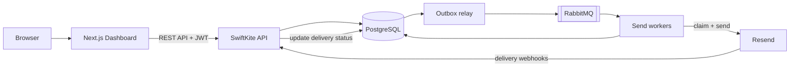

# SwiftKite

SwiftKite is an email campaign management platform that helps users create,
personalize, send, and track email campaigns from one dashboard.

Instead of sending the same email to every recipient, users can create a
reusable email template and personalize it with recipient-specific details such
as a name or company. Before sending, they can preview how the email will look
for a given set of recipient data. Once a campaign is launched, SwiftKite tracks
delivery outcomes and provides controls to pause, resume, or stop a campaign.

The project combines a web dashboard, a backend API, a database, and background
processing to make campaign delivery manageable and more reliable.

[Quick Overview Video](Demo.mp4)

## Project at a glance

- **Project type:** Full-stack email campaign management platform
- **Primary use case:** Create, personalize, send, and monitor email campaigns
- **Frontend:** Next.js, React, Tailwind CSS
- **Backend:** Java and Spring Boot
- **Database:** PostgreSQL
- **Background processing:** RabbitMQ
- **Email delivery provider:** Resend
- **Authentication:** Email/password and Google sign-in

## The problem SwiftKite solves

Sending a campaign involves more than writing an email. A sender also needs to
manage a recipient list, personalize messages, catch missing information before
sending, and understand what happened after launch.

SwiftKite brings these tasks into one workflow:

1. **Create a campaign** - add a subject, preview text, and email content.
2. **Personalize messages** - use placeholders such as `{{ name }}` or
   `{{ company }}` to insert recipient-specific information.
3. **Manage recipients** - add recipients and edit their details in a table.
4. **Preview before sending** - check how the message will appear with a
   recipient's information.
5. **Launch and control delivery** - start a campaign, pause it, resume it, or
   stop it.
6. **Track results** - view delivery progress and outcomes such as delivered,
   bounced, or complained about.

## Key features

### Campaign creation and editing

Create and manage campaigns with an email subject, preview text, and HTML body.
Draft campaigns can be edited before they are sent.

### Personalized email templates

Use placeholders in the subject and body to customize each message. SwiftKite
checks that the required placeholder values are available for recipients before
a campaign is sent, helping prevent incomplete emails.

### Recipient management

Paste recipient batches as JSON (up to 500 per batch), update individual
recipient details, and rename or remove a field across the recipient list.
Duplicate recipients in a batch are skipped.

### Preview before sending

Render a template with sample recipient data so the sender can check the
personalized subject and message without sending an email.

### Campaign controls

Pause a campaign temporarily, resume a paused campaign, or stop a campaign.
Pending messages are handled according to the selected action, while messages
already being processed are allowed to resolve.

### Delivery tracking

Follow campaign progress from the dashboard. SwiftKite records delivery states
and processes provider notifications for delivered emails, bounces, and
complaints.

### Account management

The platform includes sign-up, sign-in, Google OAuth, password reset, and
account settings.

## How it works

At a high level, SwiftKite separates the user experience from the work of
sending emails.

1. The user creates a campaign and adds recipients through the web dashboard.
2. The backend validates the campaign and recipient data.
3. When the user sends the campaign, SwiftKite saves the delivery records and
   the work to be processed in the database.
4. A background process signals that there are emails ready to send.
5. Background workers pick up eligible delivery records and submit the emails to
   Resend.
6. Resend sends status notifications back to SwiftKite through webhooks.
7. The dashboard uses the stored delivery information to show campaign progress.

**Design principle:** PostgreSQL is the source of truth for campaign and
delivery status. RabbitMQ helps coordinate background work, but the queue itself
is not the permanent record of which emails need processing. This design makes
the system more resilient to duplicate or missed queue notifications.

## Architecture overview



The backend uses a transactional outbox pattern: when a campaign is sent,
delivery records and background-work records are saved together in one database
transaction. A separate relay then publishes notifications to RabbitMQ. This
reduces the risk of the database recording a campaign send while the
corresponding background work is lost.

Workers claim delivery records before contacting the email provider. If a worker
encounters an uncertain outcome, SwiftKite avoids automatically sending the same
message again, reducing the risk of accidental duplicate emails. In some failure
cases, this means the delivery needs further investigation rather than an
automatic retry.

## Technology stack

| Area                    | Technology                         | Purpose                                             |
| ----------------------- | ---------------------------------- | --------------------------------------------------- |
| Frontend                | Next.js, React                     | Dashboard and campaign-management interface         |
| UI styling              | Tailwind CSS, Radix UI             | Styling and interface components                    |
| Frontend data and forms | TanStack Query, TanStack Form, Zod | API data, form handling, and validation             |
| Backend                 | Java 25, Spring Boot 4.1.1         | Application logic and REST API                      |
| Authentication          | Spring Security, JWT, Google OAuth | Protecting accounts and API access                  |
| Database                | PostgreSQL 17                      | Persistent campaign, recipient, and delivery data   |
| Database migrations     | Flyway                             | Managing database schema changes                    |
| Background jobs         | RabbitMQ, Spring AMQP              | Coordinating asynchronous email delivery            |
| Email provider          | Resend                             | Sending emails and reporting delivery events        |
| API documentation       | springdoc / OpenAPI                | Exploring and documenting API endpoints             |
| Local environment       | Docker Compose                     | Running the application and its supporting services |

## Repository structure

```text
.
├── backend/          Spring Boot API and application logic
├── frontend/         Next.js dashboard
├── docker-compose.yml
└── .env.example      Environment variable template
```

The backend contains the API controllers, business services, database access,
authentication, email-provider integration, and background-processing logic. The
frontend contains the dashboard pages, campaign editor, recipient table,
settings, and authentication screens.

## Getting started

### Prerequisites

- Docker and Docker Compose
- A Resend account and API key
- A verified sending domain in Resend
- The required authentication and webhook secrets

### Run locally

1. Clone the repository and open its root directory.
2. Create a local environment file:

   ```bash
   cp .env.example .env
   ```

3. Fill in the required values in `.env`. At minimum, configure the JWT secret,
   Resend API key, and Resend webhook secret. Check `.env.example` and the
   application configuration for the complete list. If port `5432` is already
   in use (for example by a native PostgreSQL install), set `POSTGRES_PORT` to
   another value such as `5433`.

4. Start the application:

   ```bash
   docker compose up --build
   ```

### Local services

| Service             | Address                |
| ------------------- | ---------------------- |
| Web dashboard       | http://localhost:3000  |
| Backend API         | http://localhost:8080  |
| RabbitMQ management | http://localhost:15672 |
| PostgreSQL          | localhost:5432         |

The backend applies the database migration on startup. API documentation is
available through Swagger UI when `SPRINGDOC_ENABLED=true`.

**Important:** The sender email address must belong to a domain verified in
Resend. The project uses a configured system sender address; campaigns can
customize the sender's display name, but not the underlying sender email
address.

## Reliability and delivery handling

Email delivery depends on both SwiftKite and the external email provider, so the
project includes safeguards for common failure scenarios:

- **Database-backed work tracking:** Campaign delivery records remain stored in
  PostgreSQL.
- **Background processing:** Email sending is handled outside the immediate web
  request.
- **Campaign controls:** Users can pause, resume, and stop campaigns.
- **Provider error handling:** Authentication errors and rate limits can pause
  sending so the problem can be addressed before resuming.
- **Webhook verification:** Incoming delivery notifications are checked for
  authenticity and duplicate events are handled.
- **Status reconciliation:** Background checks help resolve work that has been
  left in an intermediate state.

These safeguards improve visibility and control, but they do not guarantee that
every email will always be delivered successfully.

## Current limitations

SwiftKite is a working project with some deliberate or current limitations:

- Campaigns send immediately; scheduling for a future date or time is not
  available.
- Uncertain send outcomes are not retried automatically, to avoid potentially
  sending duplicate emails.
- Delivery tracking handles delivered, bounced, and complained-about webhook
  events; other provider outcomes may not be reflected, and a delivery can
  remain `ACCEPTED` indefinitely.
- Provider-related pauses require a manual resume.
- The sender email address is configured centrally; only the display name can be
  changed per campaign.
- Accounts do not yet support shared teams, workspaces, or multiple permission
  roles.
- The sign-in email address cannot currently be changed.
- There is no unsubscribe or compliance tooling (no unsubscribe link,
  `List-Unsubscribe` header, or suppression list).
- Campaign HTML is trusted from the authenticated creator; placeholder values
  are HTML-escaped, but the template markup itself is not sanitized.
- Campaign deletion is permanent and removes the campaign's recipients and
  delivery records.
- Automated tests are not yet included; verification is currently manual.

## Summary

SwiftKite is a full-stack email campaign platform designed around the complete
campaign lifecycle: create, personalize, preview, send, and track. Its dashboard
makes campaign management accessible, while the backend uses database-backed
delivery tracking and background processing to coordinate email sending and
handle provider updates.

The project is built with Next.js, Spring Boot, PostgreSQL, RabbitMQ, and Resend,
with a focus on practical application architecture, delivery visibility, and
failure handling.
